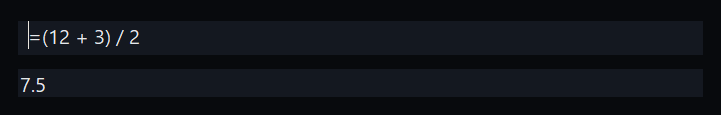
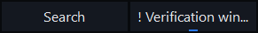
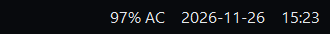
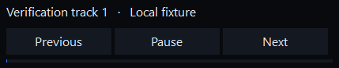
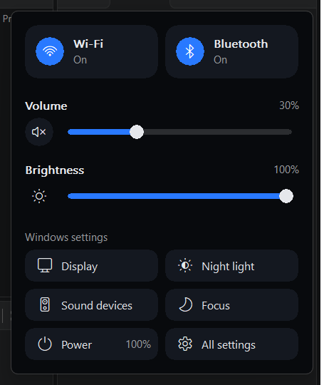
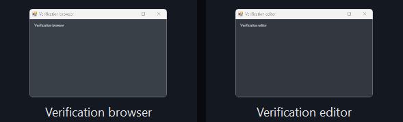
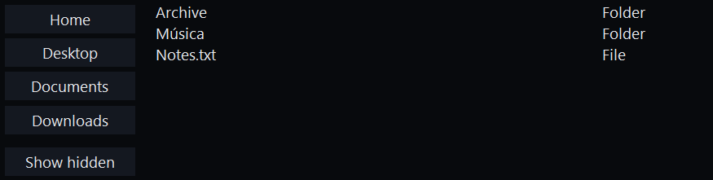
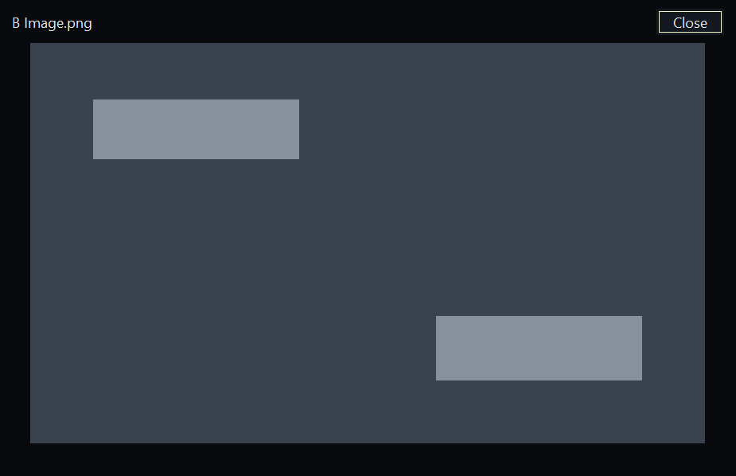
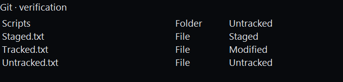

# Monolith

Monolith is an experimental native desktop companion for Windows 11. The first build provides Spotlight, a local application launcher for Start menu shortcuts.

## Build and run

Use native Windows with the Rust MSVC toolchain and a Windows SDK.

```powershell
cargo build --locked --release
.\target\release\monolith.exe
```

Spotlight opens as a compact, borderless overlay centred near the top of the active display. Type an application name, use the arrow keys to select a match, and press Enter or double-click to open it. Escape or a focus change dismisses Spotlight. Pass `--resident` to keep the launcher available after dismissal when its global shortcut registered successfully. Use `--safe-mode` to start with defaults and the global shortcut disabled.

Start a query with `=` to calculate locally. Try `=(12 + 3) / 2`. The calculator supports decimal numbers with a decimal point, parentheses, addition, subtraction, multiplication and division.

Start a query with `@` to find an open window by its title. Press Enter or double-click to switch to it, restoring it first if it is minimised. Press F5 to refresh the list. The window search uses desktop windows exposed by Windows, including packaged applications when they have an eligible desktop window.

Launch with `--dock` to show the experimental Dock. It floats along the bottom of the selected display and hides when a foreground window enters fullscreen there. Click a window to switch to it, or click its button again while it is active to minimise it. A group opens a native menu for choosing one of its windows. Hover over a running tile to preview its active or first visible window. **Search** opens Spotlight. **Exit** stops Monolith. The Dock shows up to eight pins and window groups depending on available space.

Launch with `--top-bar` to show a borderless status bar on the primary display. Windows reserves space for the bar so maximised windows keep their captions accessible. It displays the local date and time, plus battery status when available. Right-click the bar to open Spotlight, Control Center or exit Monolith. The bar hides during fullscreen use or when a maximised foreground window extends into the strip despite the reservation.

Launch with `--island` to display the title and artist from the current Windows media session. Click the media label to expand the artwork and play, pause, previous and next controls where the source provides them. A progress strip appears when Windows reports a valid timeline. Use `--island --top-bar` to place it in the centre of the status bar. The Island hides during fullscreen use and when Windows has no matching media session.

Launch with `--control-center` or use the Top Bar menu to open a borderless panel. It adjusts volume and mute for the Windows default audio output and shows the battery percentage when available. The settings buttons open the corresponding Windows pages for Wi-Fi, Bluetooth, display, night light, sound devices, focus and power. Use Tab and the arrow keys to navigate and adjust the volume. Escape or a focus change closes the panel.

Launch with `--mission-control` or select **Mission Control** from the Dock or Top Bar context menu. The borderless overview shows open windows with live Windows thumbnails where available. Click a window or select it with the arrow keys and Enter. Use Page Up and Page Down for more windows and F5 to refresh the inventory. **Previous desktop** and **Next desktop** switch to the adjacent Windows desktop. **Windows Task View** opens the original desktop manager for creating, arranging and moving windows between desktops.

Launch with `--files` or select **Files** from a shell context menu. Pass a folder after `--files` to start there. The native window provides a virtualised list, shortcuts to standard folders and a location field. Use Ctrl+L for the location field, Alt+Left and Alt+Right for history, Alt+Up for the parent folder, Ctrl+H for hidden files and F5 to refresh. Open a selected folder or file with Enter or a double-click. File activation uses the Windows default application. Press F2 to rename an item or Ctrl+Shift+N to create a folder. Both actions are available from the Files context menu and reject existing destination names.

Press Space on a file or folder in the list to open Quick Look. It shows common image formats, the first PDF page, UTF-8 or UTF-16 text and basic item details. Markdown and source files are displayed as literal text. Press Space or Escape to return to the list.

Select **Show Git** or press Ctrl+G to see the current branch, locally known upstream counts, and staged, modified, untracked or conflicted items. Folder rows summarise changes within them. The view uses an installed Git for Windows and refreshes on navigation or F5. Git status starts off in each Files window.

Use **Open terminal here** in the Files context menu to start a terminal in the displayed directory. Monolith uses Windows Terminal when its alias is available and uses Windows PowerShell as the fallback. Set `files_ide` to the absolute path of a local IDE executable to show **Open in configured IDE**. It opens the selected folder, or the displayed directory when a folder is unavailable in the selection.

Monolith tries Win+Space first and uses Ctrl+Alt+Space as a temporary fallback when Windows reserves the preferred chord. With `--resident`, pressing the registered shortcut again dismisses Spotlight. Escape returns focus to the previous window when Windows permits it. Safe mode disables global shortcuts.

Monolith reads `%LOCALAPPDATA%\Monolith\config.toml` at startup.

```toml
theme = "dark"              # dark, light
language = "english"        # english, portuguese
# files_ide = 'C:\Tools\IDE.exe'
shortcut = "ctrl-alt-space" # win-space, ctrl-alt-space, disabled
dock = false               # set true to opt in
dock_pins = ["Visual Studio Code"] # exact Start menu shortcut names, in display order
dock_monitor = "primary"           # primary, active
dock_auto_hide = false             # reveal at the bottom of the work area
dock_original_icons = false       # keep the original Shell colours when true
top_bar = false            # set true to opt in
island = false             # set true to opt in
```

Pins are resolved from local Start menu shortcuts. Missing and repeated names are skipped. Pins take the first available slots in the Dock. Drag a pin onto another pin to reorder it. The order is saved in `dock-order.toml` next to the configuration and takes precedence over the list. Remove the order file to restore configuration order. Windows Shell icons are monochrome by default, with names available through native tooltips and accessibility. A tile uses its text label when the Shell cannot supply an icon.

Invalid settings are preserved on disk and defaults are loaded. Rename the file to restore defaults on the next start.

## Project status

- Implemented in the experimental build. Native Win32 launcher, local ranking of desktop shortcuts and open windows, calculator, opt-in running-window Dock, configurable shortcut, light and dark themes, and safe start.
- Planned. Simultaneous per-display Docks, additional Top Bar modules, media and Android integrations for Control Center, workspaces, Files layout and operations, indexing, optimisation, installer and release validation.
- Unsupported by the current launcher. UWP app discovery, file search, web search and arbitrary command execution.

The UI runs on the Win32 message queue and renders on demand. Spotlight builds its catalog on first use. Search and configuration are independent of Win32, with unit tests for ranking, discovery and recovery.

See [architecture](docs/architecture.md) for the implementation boundaries and roadmap.

See [project status](MONOLITH_STATUS.md) and [benchmark procedure](benchmarks/README.md).


















